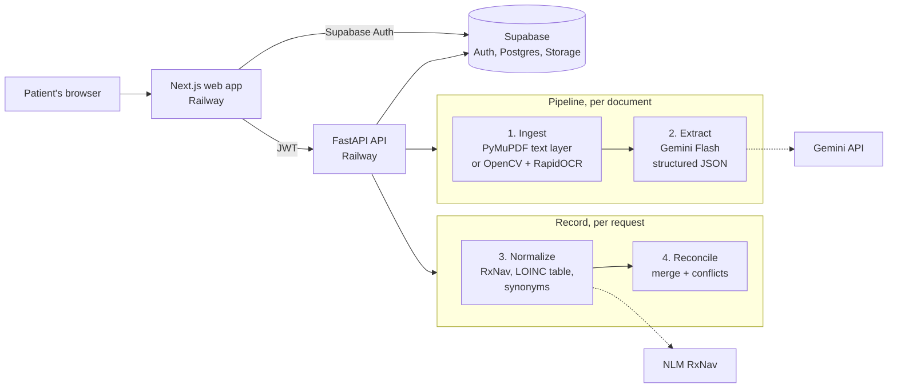

# CaSanté

**Your health history, from every clinic, in one place, with receipts.**

CaSanté (from *carnet de santé*, the French health record booklet) turns scattered medical
records, both PDFs and phone photos from different clinics, into one record a patient can
check and bring to their next doctor. Every fact links back to the exact line it came from,
and when documents disagree the app flags it instead of silently picking one.

**Live demo:** <https://web-production-cbfd2.up.railway.app>. The demo login is printed on the
sign-in page; it opens a seeded patient with five documents and two conflicts.

> All data in this project is synthetic. Don't upload real medical records.

Built in 48 hours for HealthHack 48 by Valentin and Sacha.

## The problem

- 83% of patients have repeated their health history, and 42% spend 6+ minutes
  recounting it at every appointment (Fierce Healthcare).
- 57% found getting their records stressful or confusing, and 29% had to cancel an
  appointment because records were not available (Sequoia Project).
- Only 8% to 19% of family physicians say outside data is automatically available and easy
  to reconcile in their EHR (TechTarget, JAMA Network Open).

When records are fragmented, the clinician may decide without the recent labs, the
allergies or the current medications. The patient is the one person who has all the
documents, but as a pile of papers and PDFs.

## What it does

1. **Upload** PDFs or phone photos. Each file shows live status: queued, reading,
   extracting, done.
2. **See one record**: medications, allergies, conditions, labs and procedures merged
   across documents, each with the number of documents that mention it.
3. **Check the source**: click any fact to open the page it came from, with the line
   highlighted.
4. **Review conflicts**: when documents disagree, a card asks a question for the doctor,
   such as "City hospital says 500 mg, family clinic says 1000 mg. Ask which is current."
   The app never decides which side is right.
5. **Export** the record as a FHIR R4 bundle from the API (`GET /record/fhir`).

### The demo patient

Elena Duarte has five documents from a city hospital, a family clinic, a cardiologist and
a pharmacy, two of them phone photos. Her 2025 hospital discharge lists metformin 500 mg
and a penicillin allergy; every later document says metformin 1000 mg, and both later
letters say "No known drug allergies". CaSanté surfaces both, with sources.
`data/demo/live/` holds two more documents to upload during a demo: a later lab panel
(HbA1c trend) and an urgent care letter that adds a new lisinopril dose conflict.

## Architecture



The web app signs in with Supabase and only talks to the API. The API verifies the
Supabase JWT (ES256, through the project's JWKS), stores originals and page images in a
private bucket, and runs each upload as a background task.

| Layer | Choice |
| --- | --- |
| Frontend | Next.js, Tailwind, shadcn/ui |
| Auth, database, files | Supabase |
| Backend | FastAPI, Python 3.11 |
| PDF text | PyMuPDF |
| OCR | OpenCV cleanup + RapidOCR (ONNX, CPU) |
| Extraction | Gemini Flash through `google-genai`, schema-constrained JSON |
| Medication codes | NLM RxNav REST API |
| Hosting | Railway, two services from one repo |

### The pipeline

1. **Ingest** ([ingest.py](api/app/pipeline/ingest.py), [ocr.py](api/app/pipeline/ocr.py)).
   A digital PDF is read line by line from its text layer, with a bounding box per line.
   A photo, or a PDF page without text, is turned upright, flattened to the sheet of paper
   and contrast-boosted, then read with RapidOCR. Every line gets an id like `p1-L12` and a
   box in page-image pixels, and every page is saved as a PNG for the source viewer.
2. **Extract** ([extract.py](api/app/pipeline/extract.py)). Gemini receives only the
   numbered lines (`[p1-L12] Metformin 500 mg twice daily`) and returns JSON matching a
   Pydantic schema. It must cite line ids for every item, and items citing lines that don't
   exist are dropped, so a fact without a source can't reach the record. Results are cached
   by the file's SHA-256.
3. **Normalize** ([normalize.py](api/app/pipeline/normalize.py)). Medication names go
   through RxNav to get an RxCUI and ingredients, so "Metformin HCl 500mg tab" and
   "metformin 500 mg" match. Doses and frequencies are parsed. Lab names are fuzzy-matched
   to a LOINC table and converted to one unit. Allergies and conditions get a synonym map.
4. **Reconcile** ([reconcile.py](api/app/pipeline/reconcile.py)). Items with the same
   normalized key merge and keep every source. A different dose or frequency is a
   conflict; a later "stopped" ends the earlier mentions; lab results on different dates
   are a trend, not duplicates. An allergy missing from a discharge summary or clinic letter
   is flagged, because those documents are expected to list every allergy.

## Evaluation

[eval/run_eval.py](eval/run_eval.py) runs the API's own pipeline (ingest, OCR, Gemini
extraction, normalization, reconciliation) on rendered Synthea documents and scores the
result against Synthea's structured data. An item counts as found when it matches on code
or name, and on dose for medications or value (within 1%) for labs. Five patients also have
a planted dose conflict and a planted missing allergy across their documents, and we check
that reconciliation flags them.

| | Documents scored | Medications | Allergies | Conditions | Labs | Planted conflicts found |
| --- | --- | --- | --- | --- | --- | --- |
| Clean PDF | 23 (9 patients) | 1.00 | 1.00 | 1.00 | 1.00 | 4 of 4 |
| Phone photo | 3 (1 patient) | 1.00 | 1.00 | 1.00 | 0.92 | 2 of 2 |

Field scores are F1. Full breakdown in [eval/results/metrics.md](eval/results/metrics.md).

Read these numbers with care:

- **Partial run.** The full set is 60 PDFs and 60 photos. Our Gemini key was on the free
  tier (20 requests a day), so only the documents above finished; the table scores those
  and leaves the rest out rather than counting them as misses. The photo row is a single
  patient and says little.
- **Easy documents.** The PDFs are rendered from the same data the ground truth comes from,
  in our own clean templates, so a perfect score here means the pipeline reads regular
  layouts reliably, not that it would on real clinic letters.
- **The one photo error is real.** OCR merged words in "Glucose [Mass/volume] in Urine by
  Test strip", so the lab name no longer matched.

A clean PDF takes about 12 seconds end to end, most of it the Gemini call.

## Limitations

- **Synthetic data only.** Test patients come from [Synthea](https://github.com/synthetichealth/synthea)
  and documents are rendered from our own templates, so layouts are cleaner and more
  regular than real clinic letters. Scores on real documents would be lower.
- **Photo realism.** Phone photos are simulated with albumentations (rotation, perspective,
  blur, shadows, JPEG compression), not taken with a phone.
- **No clinical judgment.** Conflicts are listed, never resolved. A dose change that was
  intentional still shows as a conflict, because the documents alone can't tell.
- **Coding is partial.** Medications get RxCUIs from RxNav; labs use a small LOINC table
  for common tests; allergies and conditions use lowercase text plus synonyms, not SNOMED.
- **Live uploads share a free-tier Gemini quota** (20 extractions a day), so new uploads
  on the live demo can fail with "Gemini extraction failed" once it runs out. The demo
  account's documents are already processed and unaffected.
- **One patient per account**, no sharing with clinicians yet, and Gemini sees the document
  text (fine for synthetic data, not for real patient data without an agreement in place).

## Run locally

You need Python 3.11+, [uv](https://docs.astral.sh/uv/), Node 20+, a Supabase project and a
Gemini API key.

```sh
# Database: documents table and private storage bucket
supabase link --project-ref <your-project-ref>
supabase db push

# API on :8000
cd api
cp .env.example .env        # Gemini key, Supabase URL + secret key, demo login
uv sync
uv run uvicorn app.main:app --reload --env-file .env

# Web app on :3000
cd web
cp .env.example .env.local  # Supabase URL + publishable key, API URL, demo login
npm install
npm run dev
```

Seed the demo account (creates the user if needed, wipes its documents, then runs the
five demo documents through the real pipeline and checks both conflicts are found):

```sh
cd api && uv run --env-file .env python reset_demo.py
```

API checks: `uv run pytest`, `uv run ruff check app tests`, `ty check app tests`.

Evaluation (cached documents are reused, so an interrupted run resumes; `--cached-only`
re-scores without calling Gemini):

```sh
cd api && uv run --env-file .env --with matplotlib python ../eval/run_eval.py
```

### Test data

```sh
cd data
uv run python render.py --fhir synthea/fhir --out pdfs            # Synthea -> PDFs + ground truth
uv run python augment.py --pdf-dir pdfs --out-dir photos          # PDFs -> phone photos
uv run python demo.py                                             # the demo patient
```

On macOS, WeasyPrint needs Homebrew's pango: prefix with
`DYLD_FALLBACK_LIBRARY_PATH=/opt/homebrew/lib`.

## Repository

```text
api/      FastAPI service: auth, documents, record, the pipeline, tests, reset_demo.py
web/      Next.js app: login, upload, record, source viewer, conflicts
data/     Synthea patients, document templates, rendered PDFs, photos, demo patient
eval/     run_eval.py and its results
supabase/ migrations: documents table, storage bucket and policies
```
